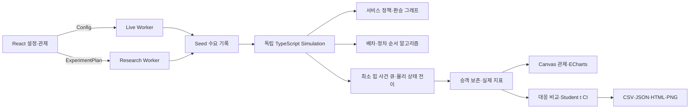

# 아키텍처

공통 계약은 `src/sim/types.ts`입니다. 엔진은 React, Worker, DOM을 import하지 않습니다. Worker는 엔진의 호스트이며, 동일 코드를 Vitest·Node 벤치마크·브라우저에서 사용합니다. 정책은 서비스 가능한 층과 환승 경로를 결정하고, 배차는 후보 차량 비용과 운행 순서를 결정합니다.

`Simulation(config, algorithm, demand?)` 생성 후 `advanceTo(t)`, `step()`, `run()`, `snapshot()`, `failCar(id)`를 호출합니다. snapshot은 복제본입니다. 조회가 사건 큐와 난수 상태를 바꾸지 않으며, 시간을 뒤로 이동하려면 같은 설정·수요로 새 인스턴스를 만듭니다.

라이브 메인 스레드는 최대 한 번의 진행 요청만 미응답 상태로 유지합니다. Worker가 선택된 전체 알고리즘을 동일 목표 시각까지 계산하고 화면에는 최대 4개 건물만 표시합니다. 세션 시각은 실행 시각의 최댓값입니다. Drain으로 첫 알고리즘이 일찍 끝나도 나머지는 계속 진행합니다. 배속은 목표 시각 증가량만 바꿉니다.

Canvas는 가감속 모델로 보간한 연속 층 좌표를 그립니다. 그래프는 10초마다 엔진에서 기록한 시계열 또는 현재 지표를 사용합니다. 초기 화면에 가상 성능 수치를 삽입하지 않습니다.

연구 Worker는 층수·대수·혼잡도·Seed를 순회합니다. 각 조합의 수요 기록을 한 번 생성한 후 모든 선택 알고리즘에 전달합니다. 수요 해시로 대응 가능성을 확인합니다. 취소는 한 실행의 경계에서 적용되며 부분 결과도 미완료 실험으로 표시합니다. 결과는 반복별 원본 지표를 유지하며 평균·SD·95% CI·한계 개선·포화 관측을 계산합니다.

검증하는 주요 불변량은 승객 보존, 중복 탑승 방지, 정원, 비음수 시간·거리, 연속 이동, 안정된 사건 순서와 Step/일괄 실행의 최종 상태 일치입니다. 종료 시 미완료 승객은 실제 상태로 남습니다. 일반 홀 호출 비용 함수에는 사전 목적지를 전달하지 않습니다. 구역별 뱅크 선택 가정과 정확한 지표 정의는 [ENGINE](ENGINE.md), 연구 집계는 [RESEARCH](RESEARCH.md)를 참조하세요.

## 단순 화면과 데스크톱 실행

기본 진입점 `App.tsx`는 단순 화면입니다. 이전 상세 화면은 `AdvancedWorkspace.tsx`를 지연 로드하는 고급 연구 메뉴에 있습니다. `presets.ts`는 기본 시연과 Seed로 재현 가능한 다양한 랜덤 운행을 구성합니다. 단순 화면은 0.25~1000배 배속을 지원하며 완료 시 새 랜덤 조합을 시작할 수 있습니다.

층별 호출과 동시 호출은 Live Worker의 `callFloors` 명령으로 전달합니다. `manual.ts`가 같은 시각·OD·고유 음수 ID의 수요 기록을 만들고 `injectPassengers(records)`를 통해 모든 라이브 비교 엔진에 같은 기록을 주입합니다. 생성된 승객은 기존 사건 큐·환승·정원·통계를 거칩니다. 탑승 주황등과 인원/정원 표시는 snapshot의 실제 승객 배열을 사용합니다.

`SimpleComparison.tsx`도 같은 연구 Worker를 사용합니다. 현재 초기 설정을 14개 알고리즘과 3개 Seed로 총 42회 실행하며 평균·반복 차이·미완료 인원을 표시합니다. 시간 지표는 모든 반복에 표본이 있는 행만 순위에 포함하며, 일부 반복에 표본이 없으면 관측 부족으로 표시합니다. 실시간으로 추가한 수동 호출은 이 초기 설정 비교에 포함되지 않습니다. 목적지 사전 입력 방식은 별도 정보 조건으로 표시합니다.

Windows 배포본은 Electron과 정적 자산을 함께 묶습니다. `vertex://app` 프로토콜이 ASAR 안의 자산을 제공하고 Web Worker도 같은 프로토콜에서 실행됩니다. 수신 HTTP 서버나 사용자 PC의 Node/npm 설치에 의존하지 않습니다. 빌드·실행 검증은 [DESKTOP](DESKTOP.md)에 기록합니다.
